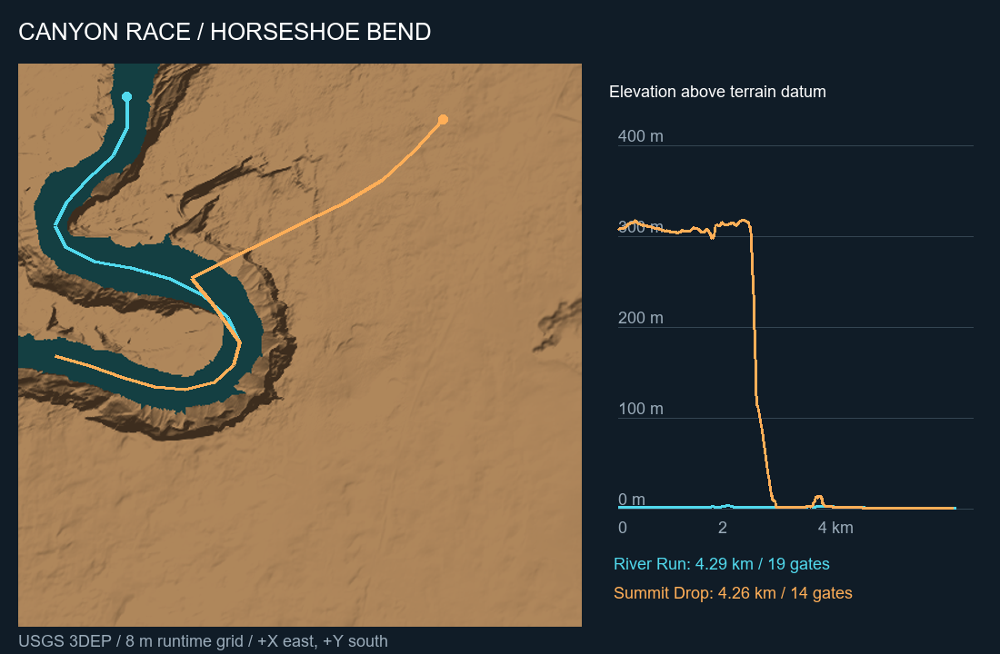

# CanyonRace

実在の峡谷を、慣性のある浮遊機で走るPCVRタイムアタック。Unreal Engine 5.8.3 / Windows / SteamVR・OpenXR。Steam FrameへPCから配信して遊ぶ試作です。

[ダウンロード](https://github.com/fuba/canyon-race/releases) · [操作ガイド](docs/playing.md) · [設計](docs/game-design.md) · [素材の出典](docs/art-sources.md)

## 遊ぶ

ReleaseのZIPを全体展開して `Play-VR.cmd` または `Play-Desktop.cmd` を実行します。
台地から川へ下るコースは `Play-Summit-VR.cmd` / `Play-Summit-Desktop.cmd`。
開発用ワークスペースからは次のように起動できます。

```powershell
.\scripts\Play-Game.ps1 -VR
.\scripts\Play-Game.ps1 -VR -Course summit
```

左スティック左右で旋回、下へ引くと揚力で上昇、上へ倒すと下降。L/Rショルダーボタンは左右のエアブレーキで、片側ならその側へ旋回、両側なら減速します。右トリガーで推力、左トリガーで両側ブレーキ、Aでブースト。右スティック押し込みで正面を合わせます。[全操作](docs/playing.md)

速度に応じて揚力とエアブレーキが効きます。停止したまま浮上することはできません。空中で入力を戻すと重力で降下します。頭の向きと動きは追従し、カメラに自動ピッチ・ロールを加えません。

## レース

- 番号順にゲートを通り、完走タイムを縮めます。コース別自己ベストを保存し、ゲートごとに自己ベスト走行とのタイム差を表示します。
- 体力100。壁では反発してダメージ。1回の通常衝突の最大ダメージは75。
- 破壊後は5秒待機して最後のゲートへ復帰。待ち時間も計時します。
- 初期1機＋予備2機。3機目を失うとDNF。手動復帰も1機消費。

| コース | 距離 | ゲート | 特徴 |
|---|---:|---:|---|
| River Run | 約4.29 km | 19 | 川沿い、12 mの人工ジャンプ2基 |
| Summit Drop | 約4.26 km | 14 | 台地から川へ約300 m降下、自然地形 |



USGS 3DEPのHorseshoe Bend周辺約4 km四方を使用。地形メッシュは8 m間隔、約51万三角形。岩肌の写真素材、HDRの空、オリジナルの機体・操縦席・音を組み合わせています。現地の写真測量モデルではなく、景観品質・操縦感は開発中です。対戦、武器、オンライン機能はありません。

自己ベストは `%LOCALAPPDATA%/CanyonRace/Records/`。入力・姿勢・フレーム時間の診断ログは `CanyonRace/Saved/Telemetry/` に保存され、外部へ自動送信しません。旧版の走行記録や自動テストのタイムは新しい操作体系の自己ベストへ混ぜません。

## ビルド

UE 5.8.3とVisual Studio 2022 C++ビルドツール・Windows SDKを別途インストールしてください。エンジンの場所が異なる場合は各スクリプトの `-EngineRoot` を指定します。

```powershell
.\scripts\Build-Prototype.ps1
.\scripts\Test-Prototype.ps1
.\scripts\Package-Game.ps1
.\scripts\Test-Packaged.ps1
```

ゲーム固有アセットはリポジトリに含まれるため、ビルドのたびに素材取得やPython環境の構築は不要です。地形の取得は `fetch_terrain.py`、画像は `fetch-art-assets.py`、オリジナルのモデル・音の生成は `generate-models-audio.py` を参照してください。既存アセットへの再取り込みは別の制作作業です。

mainのクリーンなコピーから検証付きリリースZIPを作る手順は [手動リリース](docs/release-process.md)。自動ビルドrunnerは未設置です。

## ライセンス

現時点ではソース公開であり、ゲーム固有コードのオープンソースライセンスは未選択です。[LICENSE.md](LICENSE.md) を参照してください。
USGSデータ、CC0素材、Unreal Engineと同梱ランタイムはそれぞれの条件に従います。[第三者の表記](THIRD_PARTY_NOTICES.md)
